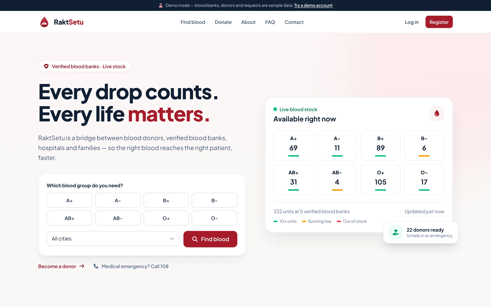

# RaktSetu — blood donor and blood bank network

RaktSetu connects donors, blood banks, hospitals, and families who need blood. It uses React, Vite, and Tailwind CSS for the website, with Express and MongoDB for the API.



This is the complete project in the `raktsetu` folder. Run commands from the folder containing this README and the root `package.json`.

## Features

| Account          | Main features                                                                                                     |
| ---------------- | ----------------------------------------------------------------------------------------------------------------- |
| Visitors         | Search verified blood banks by city and blood group, view available stock, explore compatibility, contact support |
| Patient / family | Request blood, track request status, cancel pending requests, see donors who offer help                           |
| Donor            | View matching requests, offer to donate, view donation history and eligibility information, manage availability   |
| Hospital         | Submit and track requests with facility details filled in                                                         |
| Blood bank       | Manage stock, review requests, record donations, view stock history, export CSV                                   |
| Admin            | Verify facilities, manage accounts, monitor requests, review contact messages                                     |

The app also includes profile settings, password reset by email, responsive layouts, and an optional local demo. Passwords are hashed, sessions use HTTP-only cookies, and the API enforces validation and role checks. Operational limitations are described in [the deployment guide](DEPLOYMENT.md#troubleshooting-and-operational-limits).

## Quick start: Windows and MongoDB Community

Install [Node.js](https://nodejs.org/en/download) **22.12+ within 22.x, or 24.x**, and [MongoDB Community Server](https://www.mongodb.com/docs/v8.0/tutorial/install-mongodb-on-windows/) as a Windows service. Compass is optional; it is a database viewer and does not replace Community Server.

In PowerShell, from this project folder:

```powershell
npm ci
Copy-Item server\.env.example server\.env
Get-Service MongoDB
```

Only copy the environment file on first setup. If PowerShell blocks npm scripts, use `npm.cmd` instead of `npm`. The MongoDB service should be `Running`; see [the full Windows setup](DEPLOYMENT.md#1-run-the-project-on-windows) if it is stopped or missing.

Set these values in `server/.env`:

```dotenv
NODE_ENV=development
MONGODB_URI=mongodb://127.0.0.1:27017/raktsetu
CLIENT_URL=http://localhost:5173
DEMO_MODE=false
SEED_DEMO_DATA=false
```

Generate a secret and paste it into `JWT_SECRET` in the same file:

```powershell
node -e "console.log(require('crypto').randomBytes(48).toString('hex'))"
```

Then create your admin and start the app:

```powershell
npm run create-admin
npm run dev
```

Open [http://localhost:5173](http://localhost:5173). The API runs on port 5000, and Vite forwards `/api` requests to it. The database is created when the first record is saved. Keep `server/.env` private.

### Optional local demo

On a disposable local database, run `npm run seed` and set `DEMO_MODE=true`. **Seeding replaces existing app data in the configured database.** Keep automatic seeding disabled on deployed sites.

Demo accounts share the password `Demo@1234`:

| Account          | Email                     |
| ---------------- | ------------------------- |
| Donor            | `donor@raktsetu.test`     |
| Patient / family | `seeker@raktsetu.test`    |
| Hospital         | `hospital@raktsetu.test`  |
| Blood bank       | `bloodbank@raktsetu.test` |
| Admin            | `admin@raktsetu.test`     |

### Check the build locally

```powershell
npm run test:unit
npm run build
npm start
```

Open [http://localhost:5000](http://localhost:5000) to inspect the built website served by Express. Keep `NODE_ENV=development` for this plain-HTTP local check. Vercel uses the separate function entry point and static hosting instead.

## Deploy to Vercel

Follow [DEPLOYMENT.md](DEPLOYMENT.md) for database choices, GitHub upload, Vercel settings, environment variables, and verification.

Use this project root as Vercel's Root Directory. The included `vercel.json` builds `client/dist` and routes `/api/*` to `api/index.js`, with a fallback for React pages. No `VITE_API_URL` is needed.

For local development, MongoDB Community runs on your PC. For a deployed website, Community Server must run on a secured, always-on server reachable by Vercel. A URI pointing to `127.0.0.1` cannot reach your PC from Vercel. MongoDB Atlas is an optional managed alternative. The app does not require Atlas-specific features.

## Commands

| Command                | Purpose                                                                   |
| ---------------------- | ------------------------------------------------------------------------- |
| `npm run dev`          | Start the API and Vite development server                                 |
| `npm run build`        | Build the React website into `client/dist`                                |
| `npm start`            | Run the traditional Express server, including built static files          |
| `npm run create-admin` | Create an admin or deliberately promote an existing account               |
| `npm run seed`         | Replace app data with local demonstration fixtures                        |
| `npm run test:unit`    | Run shared-domain, runtime, and test-database guard tests without MongoDB |
| `npm test`             | Run unit and API integration tests; requires MongoDB                      |
| `npm run lint`         | Check JavaScript and React code with ESLint                               |
| `npm run format:check` | Check formatting                                                          |

Integration tests use `mongodb://127.0.0.1:27017/raktsetu_test` by default. Override with `MONGODB_URI_TEST` only for a disposable database whose name ends in `_test`; fixtures replace its app data. Never use the application or production database for testing.

## Project structure

```text
raktsetu/
├── api/index.js               Vercel function entry point
├── client/
│   ├── public/                Favicon and robots.txt
│   └── src/
│       ├── components/        Shared UI, layout, blood and request components
│       ├── context/           Session and notification providers
│       ├── hooks/             Data loading, debouncing, document titles
│       ├── lib/               API client, presentation constants and formatting
│       └── pages/             Public, authentication and role dashboards
├── shared/                    Domain constants and helpers used by both apps
├── server/
│   ├── src/
│   │   ├── config/            Environment and MongoDB connection
│   │   ├── models/            MongoDB data models
│   │   ├── routes/            API routing, access checks and validation
│   │   ├── controllers/       Request handlers
│   │   ├── services/          Stock, requests, email and bootstrap logic
│   │   ├── validators/        Zod input schemas
│   │   ├── middleware/        Authentication, rate limits and error handling
│   │   └── seed/              Local demonstration fixtures
│   └── tests/                 API, runtime and database guard tests
├── vercel.json                Vercel build and routing configuration
├── render.yaml                Optional traditional Render deployment
├── Dockerfile                 Optional container build
└── DEPLOYMENT.md              Windows setup and Vercel deployment guide
```

Change colours and fonts in `client/src/index.css`, and public contact details in `client/src/lib/site.js`. Shared domain values live in `shared/` so the website and API use the same definitions.

## Configuration

The template is `server/.env.example`. Locally, copy it to `server/.env`; on Vercel, enter values in the project's environment settings.

| Variable                                                        | Purpose                                                                                              |
| --------------------------------------------------------------- | ---------------------------------------------------------------------------------------------------- |
| `MONGODB_URI`                                                   | Local Community URI by default; explicitly required in production                                    |
| `JWT_SECRET`                                                    | Random login secret of at least 32 characters; required in production                                |
| `CLIENT_URL`                                                    | Website origin for reset emails; required HTTPS origin in production, without a path or query        |
| `NODE_ENV`                                                      | `development` locally, `production` online                                                           |
| `ADMIN_NAME`, `ADMIN_EMAIL`, `ADMIN_PHONE`, `ADMIN_PASSWORD`    | Optional initial admin creation; remove the bootstrap password after confirming login                |
| `DEMO_MODE`                                                     | Enables local demo controls; set `false` online                                                      |
| `SEED_DEMO_DATA`                                                | Optional local startup seeding; keep `false` online; rejected on Vercel                              |
| `SMTP_HOST`, `SMTP_PORT`, `SMTP_USER`, `SMTP_PASS`, `MAIL_FROM` | Password-reset email delivery; without SMTP, no email is delivered                                   |
| `PORT`                                                          | Traditional server port; default `5000`; not needed on Vercel                                        |
| `SERVE_CLIENT`                                                  | Traditional server static hosting; use `false` on Vercel                                             |
| `CORS_ORIGINS`                                                  | Only for deliberately configured cross-origin deployments; leave unset for the included Vercel setup |

## Notes

Donor eligibility and compatibility screens provide coordination information; the blood bank's medical team determines eligibility and performs cross-matching. The app's existing eligibility rules have been retained during cleanup.

Before operational use, review the [deployment limitations](DEPLOYMENT.md#troubleshooting-and-operational-limits), especially request/inventory consistency under failures and rate limits across multiple server instances.
